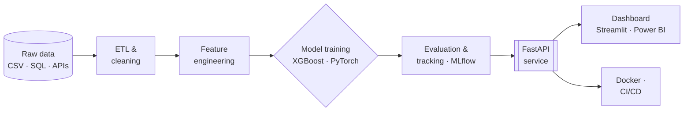

<!-- ===== HEADER ===== -->
<p align="center">
  
</p>

<p align="center">
  <a href="https://git.io/typing-svg">
    
  </a>
</p>

<p align="center">
  <a href="https://www.linkedin.com/in/richard-kuete-tiomela-a2a701288/"></a>
  <a href="mailto:richardtiomela4@gmail.com"></a>
  
  
</p>

---

## 🧠 Who I Am

```python
class RichardKueteTiomela:
    def __init__(self):
        self.school      = "ESILV – Paris La Défense"
        self.major       = "Data & Artificial Intelligence"
        self.track       = "Generative AI"
        self.location    = "Île-de-France 🇫🇷"
        self.languages   = {"French": "native", "English": "B1/B2", "Chinese": "beginner"}
        self.focus       = ["Machine Learning", "Deep Learning", "LLMs & RAG", "MLOps"]
        self.looking_for = "Data Science / AI internship · 4+ months · from April 2027"

    def motto(self):
        return "Clear, maintainable, useful code — and models that actually ship."
```

I'm passionate about understanding how data flows, how systems scale, and how insights become decisions. I enjoy:

- 🔧 designing clean and efficient data pipelines
- 📊 transforming raw datasets into actionable insights
- 🤖 building ML-powered solutions, from notebook to API
- ⚡ automating repetitive tasks and improving reliability

---

## 🔁 How I Build Data Products



---

## 🏗️ What I Do

<table>
<tr>
<td valign="top" width="50%">

### 🔹 Data Engineering
- ETL pipelines (Python, SQL, REST APIs)
- Data modeling & transformation
- Dockerized services & automation
- Linux environments & scripting

### 🔹 Data Analysis
- KPI tracking & automated reporting
- Power BI dashboards (DAX)
- Exploratory data analysis
- Data cleaning & preprocessing

</td>
<td valign="top" width="50%">

### 🔹 Machine Learning & Deep Learning
- Time-series forecasting
- Image classification (CNN, transfer learning)
- Model explainability (Grad-CAM)
- Feature engineering & evaluation

### 🔹 Generative AI & MLOps
- LLMs, RAG pipelines, LangChain
- Prompt engineering
- Model serving with FastAPI
- MLflow, Docker, GitHub Actions CI

</td>
</tr>
</table>

---

## 🚀 Featured Projects

<p align="center">
  <a href="https://github.com/richardghostr/projet-de-sante-ongle">
    
  </a>
  <a href="https://github.com/richardghostr/Prediction_de_vente">
    
  </a>
</p>

| Project | What it does | Stack |
|---|---|---|
| 🩺 **[UnguealHealth](https://github.com/richardghostr/projet-de-sante-ongle)** | AI-assisted nail disease diagnosis: 8-class CNN with Grad-CAM heatmaps and photo quality checks, inside a full web platform | `PyTorch` `EfficientNet` `OpenCV` `FastAPI` `React` `Docker` |
| 📈 **[Sales Forecasting](https://github.com/richardghostr/Prediction_de_vente)** | Multi-store forecasting pipeline: 55 time-series features, XGBoost vs LightGBM vs Prophet, **R² 0.95 · MAPE ≈ 11%** | `XGBoost` `LightGBM` `Prophet` `FastAPI` `Streamlit` `GitHub Actions` |

---

## 🛠️ Tech Stack

<p align="center"><b>Languages</b><br/>
  
</p>
<p align="center"><b>Data · ML · AI</b><br/>
  
  
  
  
</p>
<p align="center"><b>Backend · Databases</b><br/>
  
</p>
<p align="center"><b>DevOps · Cloud · Tools</b><br/>
  
</p>

---

## 📊 GitHub Insights

<p align="center">
  
</p>
<p align="center">
  
  
</p>
<p align="center">
  
</p>
<p align="center">
  
</p>

---

## 🔭 Currently

- 🧪 Training and evaluating the UnguealHealth vision model on a real dataset
- 📚 Deep diving into **LLMs, RAG and reinforcement learning for GenAI** (ESILV GenAI track)
- 🛠️ Next project: a **RAG chatbot** over technical documents
- 🎯 Preparing the **TOEFL**

---

## 🐍 Contribution Snake

<p align="center">
  <picture>
    <source media="(prefers-color-scheme: dark)" srcset="https://raw.githubusercontent.com/richardghostr/richardghostr/output/github-snake-dark.svg" />
    <source media="(prefers-color-scheme: light)" srcset="https://raw.githubusercontent.com/richardghostr/richardghostr/output/github-snake.svg" />
    
  </picture>
</p>

---

## 📫 Connect With Me

<p align="center">
  <a href="https://www.linkedin.com/in/richard-kuete-tiomela-a2a701288/"></a>
  <a href="mailto:richardtiomela4@gmail.com"></a>
</p>

<p align="center">
  
</p>
